# Netherhold — Dungeon Keeper 2 Remake & Reimplementation

**Netherhold** is an open-source, work-in-progress **Dungeon Keeper 2 remake** and
reimplementation in C#/.NET, with a Godot presentation layer. The project aims
to reproduce the original 1999 game's observable behavior while keeping its
deterministic simulation independent of the renderer.

Unlike a finished, standalone game, Netherhold is a research and development
project focused on gameplay fidelity and compatibility with the original game.
It requires your own Dungeon Keeper 2 installation for original game content;
original game files are not distributed with this repository.

This is a development and research project, not a finished replacement for the
original game. Campaign compatibility, gameplay fidelity and the Godot
presentation are still being verified. See the [current state and remaining
work](docs/HANDOFF.md) and the [implementation plan](DK2_REIMPLEMENTATION_PLAN.md).

## Screenshots

Historical screenshots from the retired Unity adapter show the front-end menus,
level briefing and Level 1.

<p align="center">
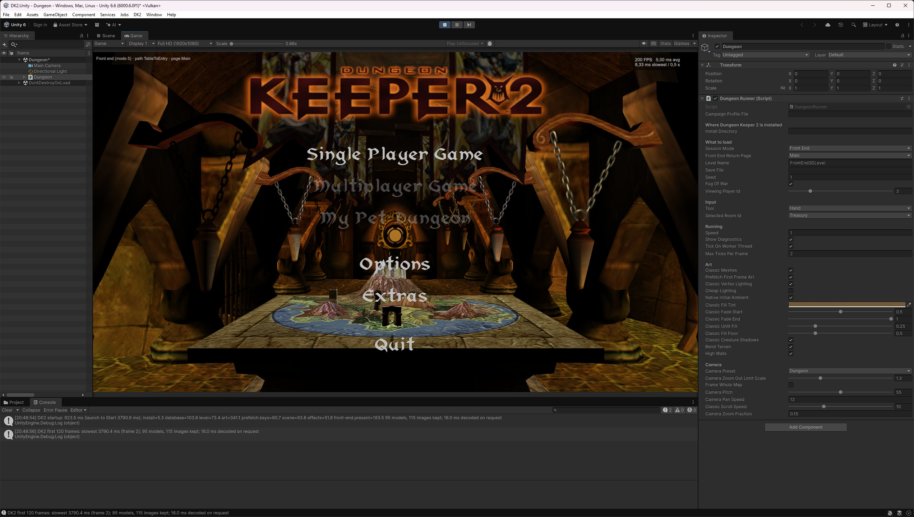
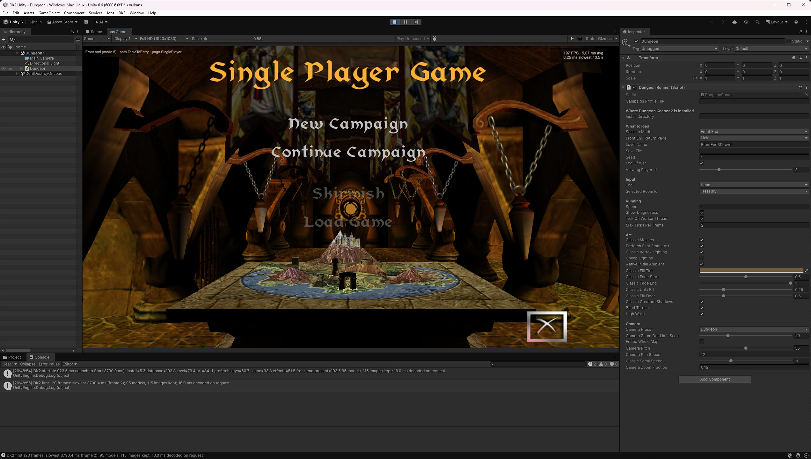
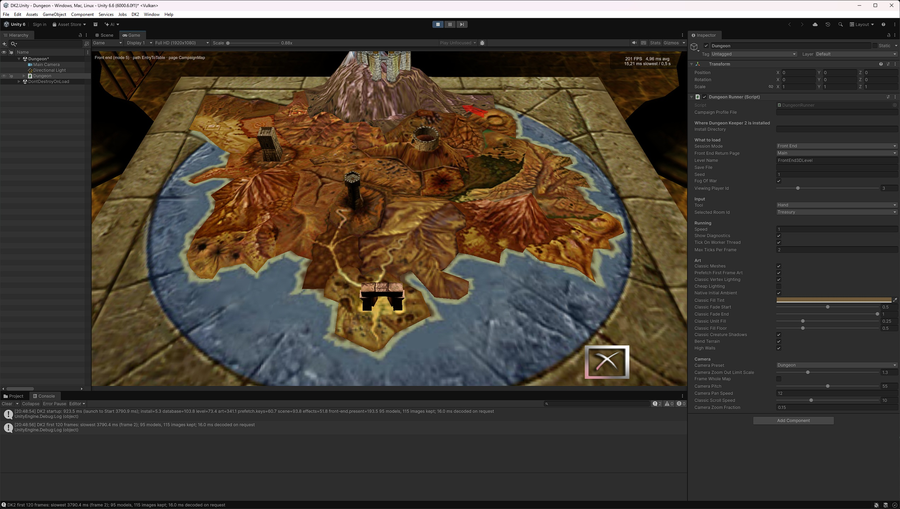
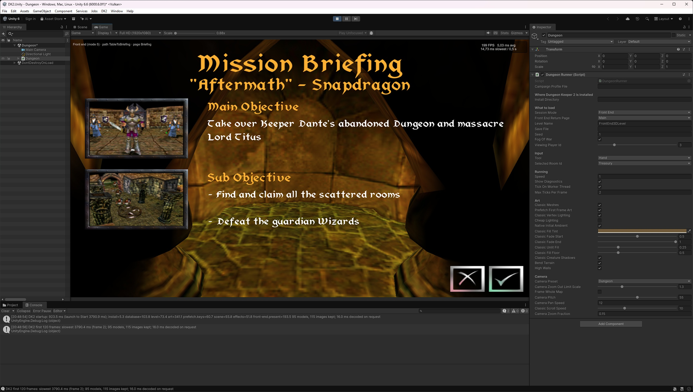
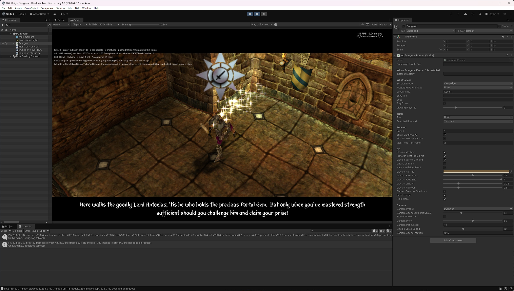
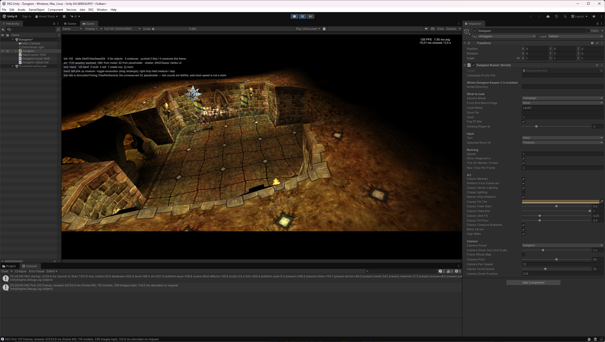
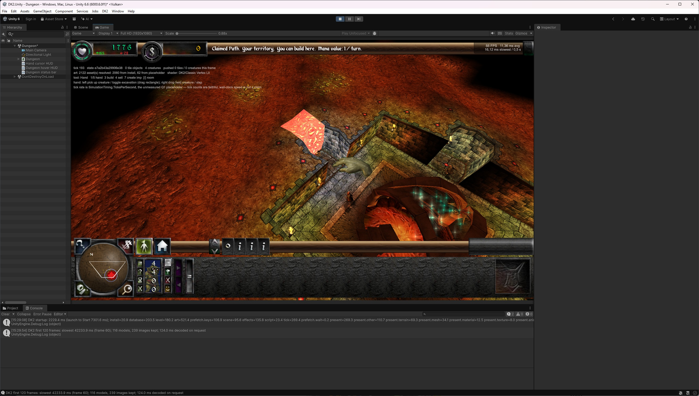
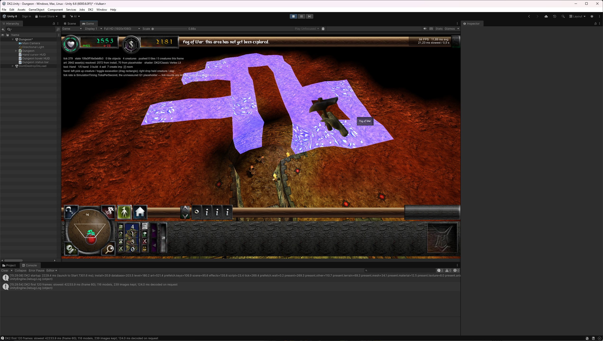
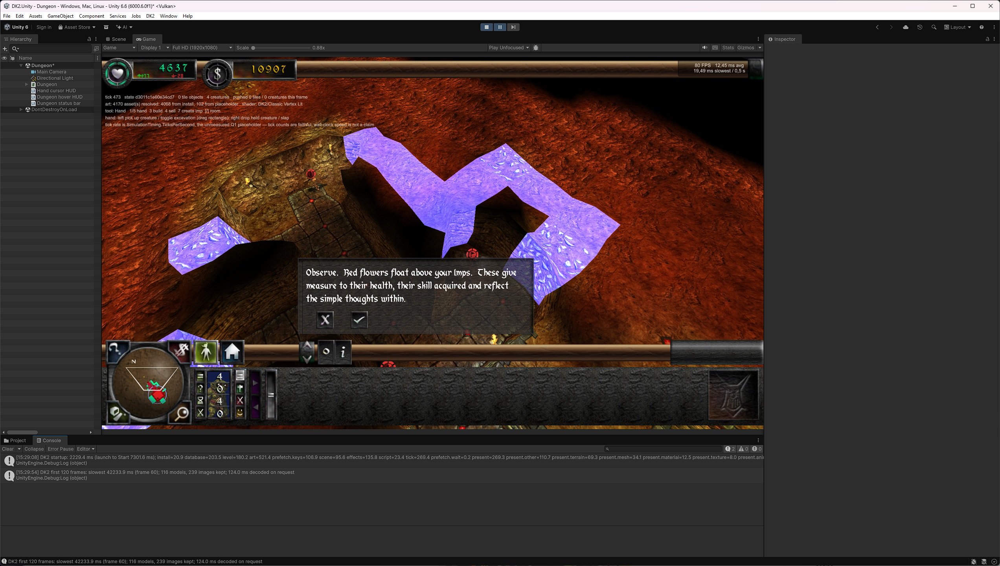
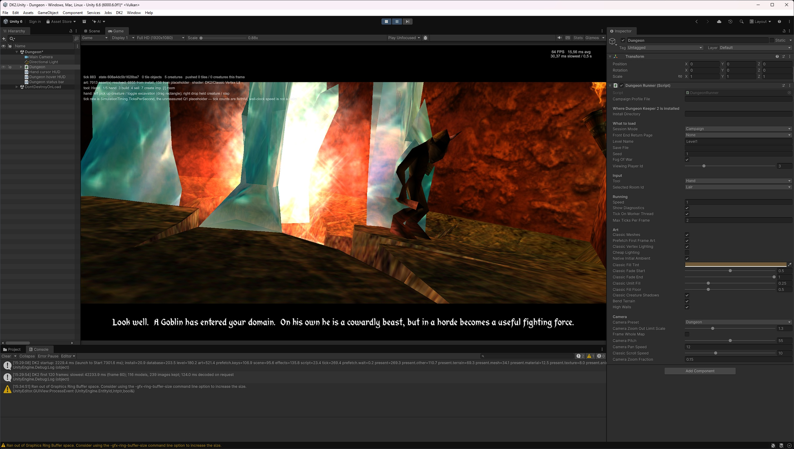
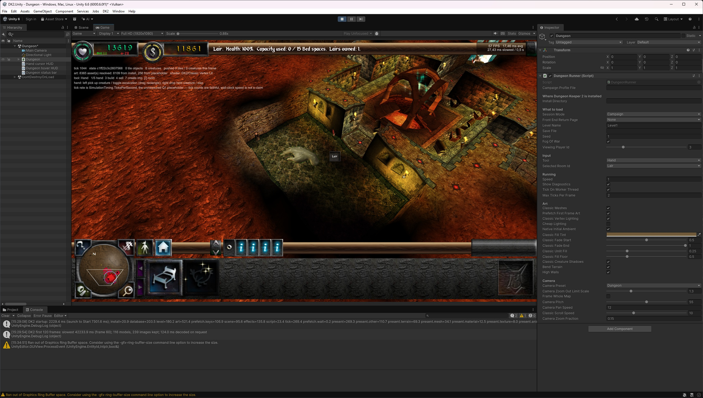
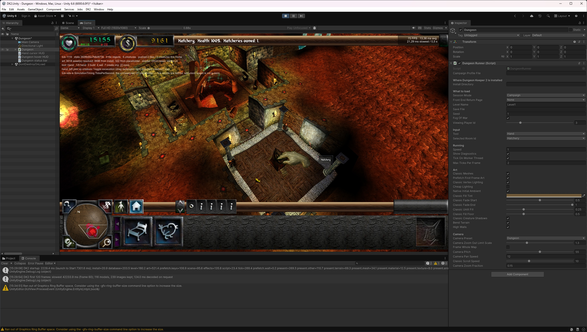
</p>

## Historical Unity performance at 1920×1080

Recorded on **2026-11-06** using a Unity 6000.6.0f1 release IL2CPP player,
Vulkan, windowed 1920×1080, VSync off. Workload: Level 6a's opening fly-by,
seed 1, one 40-second capture per frame-cap setting on an idle laptop.

| Hardware | Configuration |
|---|---|
| CPU | AMD Ryzen 7 7735HS, 8 cores / 16 threads |
| GPU | Integrated AMD Radeon Graphics; driver 32.0.21045.16010 |
| Memory | 31.2 GB usable, as reported by Windows |
| OS | Windows 11 Pro, build 26300 |

| Frame cap | Average FPS | Median frame | 99th-percentile frame | Longest frame |
|---|---:|---:|---:|---:|
| Uncapped | 186 | 5.0 ms | 12.0 ms | 34.5 ms |
| 120 FPS | 118 | 8.3 ms | 12.7 ms | 32.1 ms |
| 60 FPS | 60 | 16.7 ms | 17.1 ms | 23.2 ms |

These recorder measurements exclude the first two seconds of gameplay; including
that startup interval, the longest frames were 538, 458 and 433 ms respectively.
They describe the P1 build measured that day, before its subsequent optimizations,
and one short workload. Capture package: `20261106-125325` (recorded with local
changes). Raw captures and SHA-256 inventory are retained at
`F:/DK2Evidence/studies/readme-performance-1080p--2026-11-07--001/`.
The every-frame 60 FPS target remains unmet; see the
[measurement results](docs/plans/2026-11-06-presented-world.md#result-measured-2026-11-06)
and [performance acceptance policy](docs/PERFORMANCE.md).

## Build and test

Install the .NET SDK selected by [global.json](global.json) (.NET 10 or a newer
SDK allowed by its roll-forward policy), then run these commands from the
repository root:

```sh
dotnet restore DK2.slnx
dotnet build DK2.slnx --no-restore --configuration Release
dotnet test DK2.slnx --no-build --configuration Release
```

The solution builds without the Godot editor or an original DK2 installation. Tests that
need the original game report as skipped when its data is unavailable; a green
run with skips does not verify those integration paths. CI builds and tests on
Linux and Windows without a DK2 installation.

## Use an original DK2 installation

Playing campaign content in Godot and running scenarios with the headless
harness require your own original game files. Set `DK2_DIR` to the installation
directory containing `DKII.EXE` and `Data/`:

```powershell
$env:DK2_DIR = 'C:\Games\Dungeon Keeper 2'
```

On a POSIX shell, use `export DK2_DIR='/path/to/Dungeon Keeper 2'` instead.
The setting is authoritative: an invalid path disables install discovery rather
than falling back to another installation. To require install-dependent tests
to fail instead of skip when data is missing, also set `DK2_REQUIRE_INSTALL=1`.

Original game assets, converted assets and fonts are not bundled. Keep the game
installation outside this checkout; see [reference material](original-reference/README.md)
and [third-party notices](THIRD-PARTY-NOTICES.md).

## Run a headless scenario

After building, list the available scenarios or run the synthetic determinism
smoke scenario:

```sh
dotnet run --project src/DK2.Harness -c Release --no-build -- list
dotnet run --project src/DK2.Harness -c Release --no-build -- run scenarios/smoke/determinism_flat_map.yaml
```

The `run` command currently loads the original game database even for a
synthetic map, so it requires `DK2_DIR`. Reports, events and per-tick hashes go
under `build/scenario-runs/`. The [scenario guide](scenarios/README.md) describes
the format and what each experiment can establish.

## Run the Godot presentation

Use the .NET editor pinned by [`godot-version.json`](godot/godot-version.json). On Windows, set up
the editor and open the project:

```powershell
powershell -File godot/setup.ps1
powershell -File godot/editor.ps1
```

The launcher accepts your original DK2 install. The [Godot guide](godot/README.md)
covers controls, exports and the optional local replacement font.

## Project structure and contributing

- [Architecture](docs/ARCHITECTURE.md): simulation, data, assets, AI and presentation boundaries.
- [Research status](docs/RESEARCH_STATUS.md) and [experiments](docs/EXPERIMENTS.md): evidence and fidelity coverage.
- [Decisions](docs/DECISIONS.md): architectural and behavioral choices.
- [Godot project](godot/README.md): the Godot adapter's toolchain, its front-end menu and in-game HUD, and the level's terrain.
- [Command-line tools](src/DK2.Tools/README.md): data inspection, conversion and repository checks.
- [Contributor instructions](AGENTS.md): research rules, documentation budgets and evidence storage.
- [Art direction](docs/ART_DIRECTION.md) and [asset pipeline](docs/ASSET_PIPELINE.md): visual fidelity and asset work.

Before changing behavior, research the original binary and shipped data rather
than guessing. Keep gameplay deterministic and integer-based, route asset access
through the asset abstraction, and record confirmed facts separately from
inferences and unknowns. Install the local documentation hook once per clone
with `git config core.hooksPath .githooks`.

## License

Project source is licensed under [GPL-3.0-or-later](LICENSE). Dependencies and
referenced projects retain their own terms; see [THIRD-PARTY-NOTICES.md](THIRD-PARTY-NOTICES.md).
The project license does not grant redistribution rights to original DK2 files.

This repository contains no original DK2 game files. Everything the game needs
is read at run time from your own installation (`DK2_DIR`). The screenshots
above show the original game's artwork as this build renders it from such an
installation. Dungeon Keeper is a trademark of its owner; this project is not
affiliated with or endorsed by Electronic Arts or Bullfrog Productions.
