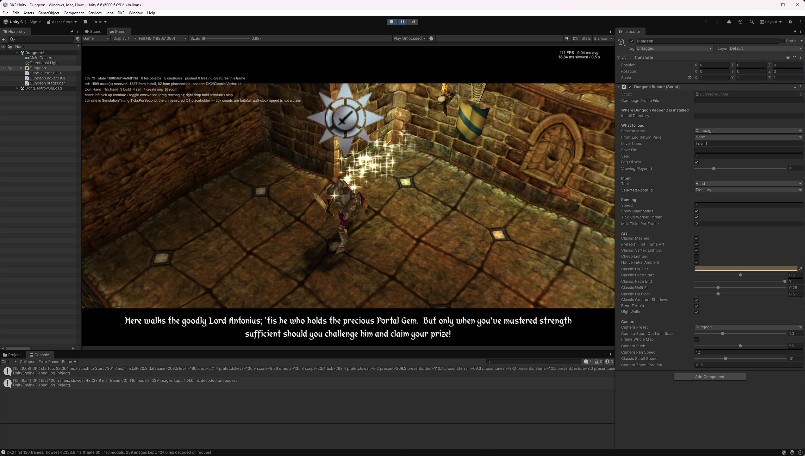
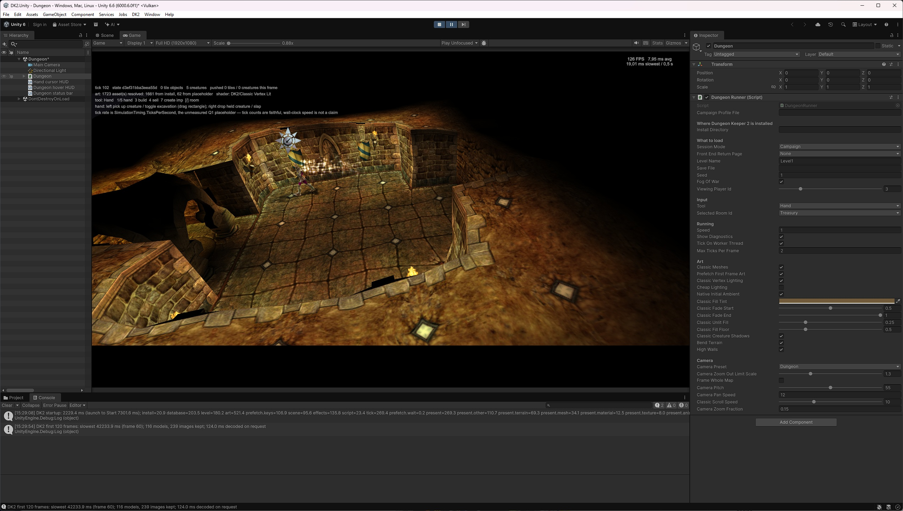
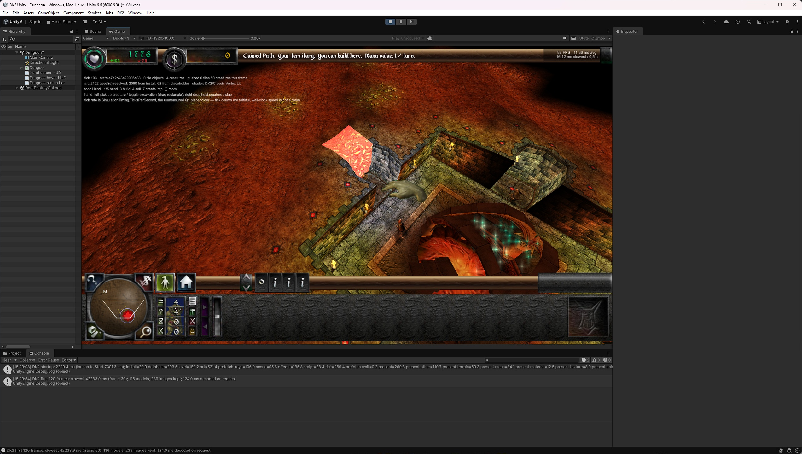
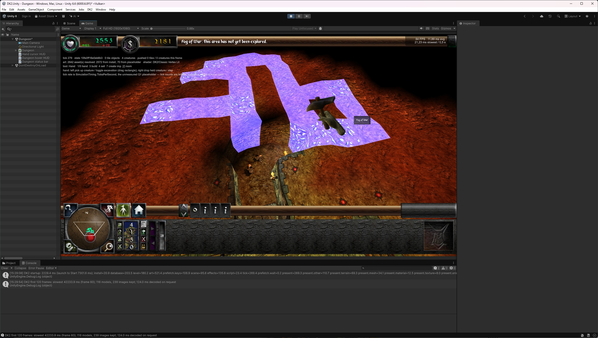
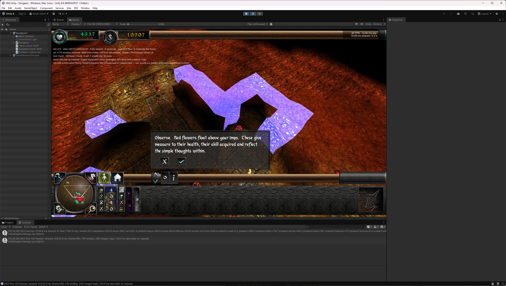
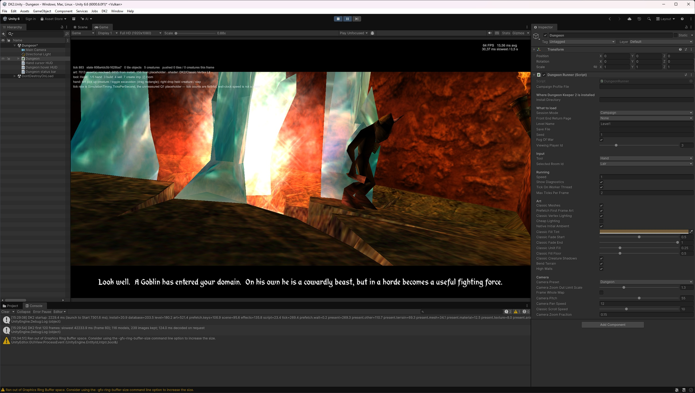
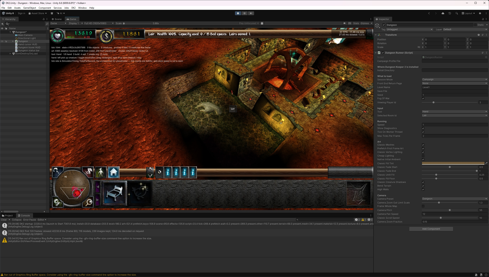
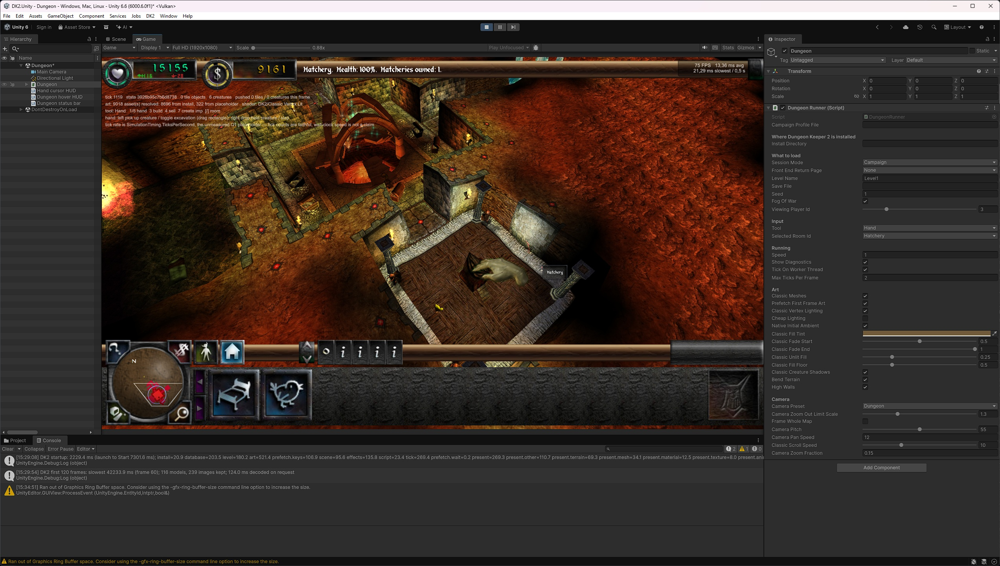

# Dungeon Keeper 2 reimplementation

A work-in-progress reimplementation of Dungeon Keeper 2 in C# with a Unity
presentation layer. The aim is to reproduce the original game's observable
behavior while keeping the simulation independent of its renderer.

This is a development and research project, not a finished replacement for the
original game. Campaign compatibility, gameplay fidelity and the classic Unity
presentation are still being verified. See the [current state and remaining
work](docs/HANDOFF.md) and the [implementation plan](DK2_REIMPLEMENTATION_PLAN.md).

## Screenshots

The classic Unity presentation on Level 1, captured from the current build.

<p align="center">








</p>

## Build and test

Install the .NET SDK selected by [global.json](global.json) (.NET 10 or a newer
SDK allowed by its roll-forward policy), then run these commands from the
repository root:

```sh
dotnet restore DK2.slnx
dotnet build DK2.slnx --no-restore --configuration Release
dotnet test DK2.slnx --no-build --configuration Release
```

The solution builds without Unity or an original DK2 installation. Tests that
need the original game report as skipped when its data is unavailable; a green
run with skips does not verify those integration paths. CI builds and tests on
Linux and Windows without a DK2 installation.

## Use an original DK2 installation

Playing campaign content in Unity and running scenarios with the headless
harness require your own original game files. Set `DK2_DIR` to the installation
directory containing `DKII.EXE` and `Data/`:

```powershell
$env:DK2_DIR = 'C:\Games\Dungeon Keeper 2'
```

On a POSIX shell, use `export DK2_DIR='/path/to/Dungeon Keeper 2'` instead.
The setting is authoritative: an invalid path disables install discovery rather
than falling back to another installation. To require install-dependent tests
to fail instead of skip when data is missing, also set `DK2_REQUIRE_INSTALL=1`.

Original game assets, converted assets and fonts are not bundled. Keep the game
installation outside this checkout; see [reference material](original-reference/README.md)
and [third-party notices](THIRD-PARTY-NOTICES.md).

## Run a headless scenario

After building, list the available scenarios or run the synthetic determinism
smoke scenario:

```sh
dotnet run --project src/DK2.Harness -c Release --no-build -- list
dotnet run --project src/DK2.Harness -c Release --no-build -- run scenarios/smoke/determinism_flat_map.yaml
```

The `run` command currently loads the original game database even for a
synthetic map, so it requires `DK2_DIR`. Reports, events and per-tick hashes go
under `build/scenario-runs/`. The [scenario guide](scenarios/README.md) describes
the format and what each experiment can establish.

## Run the Unity presentation

Use the editor version pinned in
[ProjectVersion.txt](unity/DK2.Unity/ProjectSettings/ProjectVersion.txt), currently
Unity 6000.6.0f1, with an activated editor license. On Windows, build and copy the
Unity-compatible assemblies with:

```powershell
powershell -File unity/sync-assemblies.ps1
```

Open `unity/DK2.Unity`, open `Assets/DK2/Scenes/Dungeon.unity`, and press Play with
`DK2_DIR` set or the DungeonRunner component's Install Directory configured.
Rerun the sync script after changing the shared C# projects. See the
[Unity guide](unity/README.md) for controls, adapter checks and rendering limits.

## Project structure and contributing

- [Architecture](docs/ARCHITECTURE.md): simulation, data, assets, AI and presentation boundaries.
- [Research status](docs/RESEARCH_STATUS.md) and [experiments](docs/EXPERIMENTS.md): evidence and fidelity coverage.
- [Decisions](docs/DECISIONS.md): architectural and behavioral choices.
- [Command-line tools](src/DK2.Tools/README.md): data inspection, conversion and repository checks.
- [Contributor instructions](AGENTS.md): research rules, documentation budgets and evidence storage.
- [Art direction](docs/ART_DIRECTION.md) and [asset pipeline](docs/ASSET_PIPELINE.md): visual fidelity and asset work.

Before changing behavior, research the original binary and shipped data rather
than guessing. Keep gameplay deterministic and integer-based, route asset access
through the asset abstraction, and record confirmed facts separately from
inferences and unknowns. Install the local documentation hook once per clone
with `git config core.hooksPath .githooks`.

## License

Project source is licensed under [GPL-3.0-or-later](LICENSE). Dependencies and
referenced projects retain their own terms; see [THIRD-PARTY-NOTICES.md](THIRD-PARTY-NOTICES.md).
The project license does not grant redistribution rights to original DK2 files.
