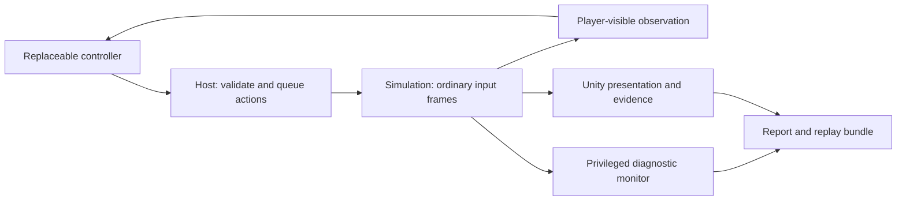

# Agentic campaign playtesting

**Date:** 2026-11-07. **Status:** owner-approved design; stages 1-2 are built (see Implementation), later stages are not.
**Purpose:** reduce the owner's repeated playtesting while establishing a reusable
foundation for external agents and a future Enhanced keeper.
**Goals:** 2 (campaign compatibility), 6 (oracle testing) and 10 (agent interface),
with support for 5 (fidelity), 9 (determinism) and 11 (presentation modes).
**Implementation:** [stages 1-2 plan](2026-11-07-campaign-player-stages1-2.md), Task 1 (detached player contract), task 2 (visibility-safe observation builder), task 3 (action admission and receipts), task 4 (tick-loop integration, replay identity, run manifest), task 5 (the `CampaignPlayer` controller), task 6 (`run --campaign-player`, limits, evidence folder, verdicts) and task 7 (the Level 1 acceptance: seeds 1-3 won headless, each with the finale reaching the gem pickup, journals replayed without the controller) are built on `feature/campaign-player`, not merged; task 7's commit and integration are pending. Stages 3 onward are not built.

## Relationship to existing work

Extend [autonomous playtesting](2026-10-27-autonomous-playtesting.md), ADR-0552,
and [Stage D Unity input](2026-10-27-stage-d-unity-input.md), ADR-0553.
Their built stages remain the baseline; this design proposes the next scope.
Do not create a competing scenario runner, journal format or simulation loop.

Existing entry points are `ScenarioController`, `ScenarioRunner`, `RunMonitor`,
`KeeperView`/`KeeperViewSnapshot`, `PlayerCommand`, and the input journals.
The current controller view is privileged, not a player observation boundary;
see the parent plan's Observations section. External-agent transport,
goal-directed campaign play and audiovisual judgment are not established by
those existing hooks.

The [architecture](../ARCHITECTURE.md) and
[Classic/Enhanced AI boundary](../KEEPER_AI.md#127-order-of-work) still apply.
Classic keeper behavior remains a researched mirror. A campaign test player,
external agent and future Enhanced keeper may share interfaces and suitable
action routines, but remain replaceable controllers. This design neither
changes Classic behavior nor claims to implement Enhanced AI or model training.

## Intended result

An explicitly launched run plays toward campaign objectives, records its
actions, detects technical failures and suspicious behavior, and leaves a
short evidence-backed report. The owner reviews exceptions and uncertain clips
instead of replaying every level after every change.

Successful play establishes that one run succeeded. It does not establish DK2
equivalence, complete level coverage, correct UI input or correct audiovisual
output. Each of those requires separate evidence and explicit coverage.
Expectations about DK2 must cite researched rules or original-game evidence;
neither the agent's opinion nor agreement with our own code establishes fidelity.

## Proposed components and boundaries

| Component | Responsibility |
|---|---|
| Player observation | Immutable, versioned information available to that player, plus current action capabilities and previous action results |
| Controller | Choose objectives and actions; keep private memory outside simulation state |
| Action routines | Decompose tasks such as building a room into ordinary, validated player actions |
| Host | Own the run, capture observations at safe boundaries, order commands, advance time and enforce budgets |
| Diagnostic monitor | Inspect full state, source-backed expectations, progress, coverage and failures without advising the player through hidden information |
| Unity adapter | Render, collect evidence and optionally supply virtual device input through the production input path |
| Agent supervisor | Optional external decision-maker, called at milestones or recovery points through the same player contract |

### Player contract

- Hide undiscovered terrain, hidden entities, enemy internals and future trigger
  knowledge. Apply the visibility policy to derived summaries, legal-action
  hints, errors and planning helpers, not only the tile array.
- Expose visible objectives/messages and relevant economy, creatures, rooms,
  tools and owned capabilities. A privileged monitor may verify hidden trigger
  progress, but cannot pass its diagnosis back as player knowledge.
- Reuse domain types for identities, positions and tick stamps. Transport uses
  explicit versioned representations and validates values at the boundary.
- Tag observations with run/session identity and a completed-tick revision.
  Commands identify the observation they depend on. Reject stale or wrong-run
  actions rather than silently retargeting them.
- Distinguish queued, applied, refused and still-pending actions. A command
  being accepted does not mean a creature has completed the requested work.
- Give bounded advance requests and explicit terminal/timeout responses. No
  controller writes `WorldState`, teleports things or invokes private rule APIs.

The initial transport boundary is local to the machine. Keep provider/network
code outside simulation and controller logic. The first implementation uses an
in-process controller; a later implementation plan selects a local IPC transport
and provider adapter without freezing an unnecessary public API now.

### Decisions, scheduling and reproduction

Start with deterministic action routines and a goal-directed baseline controller.
Its objectives can be level-specific; its routines should use observations and
conditions rather than fixed command timestamps. A second level must test their
reuse before calling the controller general-purpose.

An agent supervisor chooses objectives, examines player-visible progress and
changes strategy. It does not issue a model call per frame or replace reliable
input routines. Record decisions and issued actions separately; make malformed
responses and exhausted decision budgets explicit controller outcomes.

The host owns exactly one command source per controlled player and defines
ordering with other players' inputs. Assign action IDs so retried transport
requests cannot apply commands twice. Bound outstanding work and recovery
attempts. Late responses after cancellation or a session change are rejected.

Headless execution may wait at a completed-tick boundary for a decision, then
advance a bounded batch. Rendered execution keeps the frame responsive; commands
enter at a documented next-tick boundary. Declare whether simulation continues
or pauses while a controller waits. Freeze that policy in run metadata.
Never read a worker's mutating world; obtain a completed-tick observation through
the existing host synchronization/copy boundary.

Agent output is not assumed deterministic. Reproduction feeds the recorded
merged input frames into the same source/build and initial state without calling
the controller again. Record versions, source/build fingerprints, level/data
identity, seed, policy configuration and all applied commands. Identify dirty
builds with retained source identity rather than calling a commit alone exact.
Refuse incompatible replay inputs. Presentation timing and audio require their
own capture; a matching simulation hash does not reproduce a rendered session.

## Two execution paths

**Gameplay path:** the controller submits normal player commands. Headless runs
cover gameplay quickly; a Unity host can execute the same controller with real
rendering and audio. This path does not certify clicking, hit-testing or HUD
selection. Accelerated simulation does not certify audiovisual timing.

**Interface path:** virtual per-frame pointer, button, keyboard and camera
inputs enter the production mapping/UI path under Stage D. Tests use actual UI
geometry and check intents, commands and outcomes. Choosing a room through a
direct command is not evidence that the room button works. Connect this path to
the shared controller through an action adapter; journal which path was used.

An initial gameplay run may load Level 1 directly. Front-end selection, briefing,
save/load, result screens and campaign continuation gain separate interface
checks; do not describe direct level loading as an end-to-end campaign pass.

## Unity must leave the desktop under the owner's control

Use an isolated windowed standalone player and separate build/scratch project,
save/profile/settings locations, logs and evidence destinations. Do not save,
restart or drive the owner's editor or alter its open scene. Follow the current
[player build workflow](../../README.md#run-the-unity-presentation) and ADR-0690;
release-player checks use IL2CPP, while any diagnostic build is labelled separately.

For an automation session:

- Keep updating without requiring keyboard focus. The runner must neither
  request activation nor reclaim focus after launch, dialogs or level changes.
- Do not inject operating-system mouse/keyboard events, warp or lock the system
  cursor, install global shortcuts, or change the user's desktop display mode.
- In gameplay mode, physical input must not produce game commands or camera
  changes. In interface mode, use a virtual pointer/device source local to the
  game, isolated from real mouse/keyboard events and real UI Toolkit events.
- Keep any bot cursor inside the rendered game. Focus loss must not erase its
  virtual gesture or stop the run; explicit focus-loss tests remain distinct.
- Provide an external cancel control that works without focusing the game.
  Cancel outstanding decisions, flush evidence and stop only owned processes.
- Bound CPU demand, frame rate, ticks, duration and evidence volume. Start with
  one Unity instance. Shared-machine runs diagnose gameplay, not FPS acceptance;
  controlled performance runs follow [performance policy](../PERFORMANCE.md).
- Capture the game surface, not screenshots of the owner's desktop. Validate
  unfocused rendering/audio on the target build. Minimized/occluded execution
  must be tested before it is supported; missing output is an evidence gap.

Acceptance must demonstrate continued owner typing and pointer use in another
application during play, unchanged focus and cursor behavior, isolation of real
clicks/keys, and successful cancellation. Include launch, scene/result transitions
and errors; a background-execution flag alone is insufficient proof.

## Visual and audio review

Capture milestone screenshots and bounded clips around findings; avoid an agent
watching every frame by default. Tag evidence with session identity, simulation
tick, rendered frame and wall-clock timing so gameplay and presentation can be
correlated without assuming their clocks are interchangeable.

Visual checks cover missing content, camera/HUD problems and suspicious motion.
Compare stable fixtures or original-game references where available; model
judgments about appearance are review candidates, not automatic fidelity facts.

Audio checks have three layers: requested events, resolved/scheduled playback,
and captured mixed output. Preserve category/sample identity and timing where
available. Detect missing/empty output, clipping, repetition and overlaps with
signal checks; speech recognition and an audio-capable reviewer may add semantic
analysis later. A request log alone does not prove that sound played.

Provide quiet operation independently of evidence capture. The design must prove
that monitoring mute leaves the captured mix intact and normal game volume,
ducking and routing remain represented. Record the tap point, sample format,
channels, settings and any capture gaps. Mixed digital output does not certify
physical speakers or hardware audibility. Exact content/timing expectations need
reference evidence; do not assert waveform identity across backends or devices.

Use ordinary pacing for audiovisual timing checks. Detailed native state
recording pauses and accelerated remake simulation cannot certify normal playback.

## Verdicts and evidence

| Run/finding category | Required interpretation |
|---|---|
| Completed | Actual level verdict reached; list exercised milestones and unchecked coverage |
| Gameplay defeat | A valid game result, not automatically a defect or a successful campaign check |
| Controller limitation | Invalid strategy, repeated refused actions, unsupported action or decision-budget exhaustion |
| Technical failure | Exception, crash, hang or same-revision journal/snapshot continuation mismatch |
| Verified gameplay violation | A sourced expectation is violated, with explicit applicability and evidence |
| Suspected anomaly | Stall, unusual behavior or model-flagged visual/audio issue requiring investigation |
| Incomplete evidence | Missing capture, incompatible replay identity or an unexercised requirement; never silently pass |

Progress timeouts must account for legitimate waits such as research, digging
and combat. They identify stalled attempts, not invented DK2 rules. Controller
failure must not be counted as an engine failure; lack of victory must not be
hidden by reporting only that the process exited successfully.

The report includes objective reached, outcome, coverage, failure tick, source
of each expectation, controller decisions, refused/pending actions and replay
instructions. Attach relevant state, logs and short clips rather than a full
transcript for the owner to read. Preserve the original finding when minimizing
a reproduction, and demonstrate that the reduced input still reproduces it.

Reuse existing journals and snapshot formats. Add diagnostic checkpoints and
failure snapshots where existing restoration supports them; report restoration
limits explicitly. Bound recording before writing, and stop cleanly before a
storage budget is exhausted. No evidence folder is automatically cleaned.
Irreplaceable evidence and failure bundles go add-only to `F:/DK2Evidence/`,
with build/source identity and SHA-256 inventories under AGENTS.md's rules.

## Staged delivery and acceptance

These are separate implementation increments, not one large implementation plan.

| Stage | Deliverable and acceptance |
|---|---|
| 1. Player contract and host | Player-visible observation and normal-command adapter over the existing harness. Prove hidden-information isolation, stale/wrong-run rejection, action deduplication, bounds and recorded-input reproduction. |
| 2. Level 1 baseline | Unattended goal-directed attempt using reusable action routines. Reach the actual win verdict, or stop with a reproducible technical finding or explicit controller limitation. No human rescue or hidden-state action oracle. |
| 3. Agent supervision | A local external controller can select objectives and recover through the same contract. Bound calls/tokens/time and record responses; replay still needs no model. Try a second level to assess routine reuse. |
| 4. Rendered gameplay | Run the controller in an isolated release Unity player, prove desktop/input isolation, collect linked visual/audio evidence and review selected milestones. |
| 5. UI and campaign loop | Extend Stage D virtual input through the real UI; exercise launch/briefing, gameplay interactions, save/load, results and continuation with no desktop input injection. |
| 6. Regression portfolio | Representative levels, seeds and strategies with reproducible findings, coverage and explicit untested areas; review missed bugs and false positives. |

First reviewable implementation scope is stages 1-2. Define its Level 1 objective
sequence from the shipped level and existing research before coding assertions.
Use one declared seed first, then additional seeds with every result disclosed.
A controller limitation is a valid diagnostic deliverable, not Level 1 acceptance.
Declare stage 2 accepted only once an unattended win and its journal replay are
demonstrated. Complete rendered/interface stages before claiming automated
acceptance of the player's entire experience.
If a gameplay gap blocks completion, file a separate evidence-backed mechanic
task; do not change DK2 behavior merely to make the controller win or treat an
unbounded series of gameplay fixes as completion of this increment.

Track human review time, useful reproducible findings, false alarms, coverage,
success by level/seed, run cost and model usage. Broader automation should reduce
repeated owner work; it does not require every level-specific routine to generalize.
Use headless checks frequently and selected rendered runs for presentation work.
Runs remain explicitly launched and bounded; no unattended schedule is authorized
by this design. Provider selection, credentials and any external data transfer
must be settled before enabling a remote model backend.

## Original DK2 and deferred scope

Original-game bot control is a separate optional project. Prioritize existing
native packets/replays, targeted scripts and focused owner captures where they
are cheaper. Do not require a general native campaign player to build this
remake interface. Native and remake drivers are different; recording comparable
inputs and initial conditions requires explicit mapping and validation.

If later justified, a native bot would record normal play and audiovisual output,
then use packet replay for detailed state capture. The
[native recorder's timing limits](../../tools/oracle/native-capture.md#coverage-and-limits)
still apply. Bot completion supplies a reference scenario, not exhaustive DK2
behavior coverage. Bound any feasibility trial by the manual work it replaces.

Model training, reinforcement learning, distributed execution, a general native
campaign bot and a production Enhanced keeper are outside the first increments.
Their future value motivates clean interfaces, not early implementation of them.

## Next design gate

Execution agents must use the applicable [repository .NET skills](../../.agents/skills/README.md),
with explicit emphasis on measured performance and allocation cost. The
[implementation plan](2026-11-07-campaign-player-stages1-2.md#net-skills-and-optimization-gate)
owns skill routing and the optimization gate. Performance improvements must
preserve player-information isolation, snapshot lifetime and deterministic
outcomes for the same applied inputs; reducing fidelity or evidence coverage is
not an optimization. Apply this requirement to later implementation plans too.

The owner approved this design. Review the [stages 1-2 implementation plan](2026-11-07-campaign-player-stages1-2.md)
and select an execution method before implementation. Later stages require their
own concrete plans and measured acceptance.
Implementation must retain the repository's reviewer/documenter protocol and
verify that observation, monitoring and recording do not change simulation
outcomes for the same applied input frames. This document records requirements
and proposed architecture; it changes no executable behavior or fidelity verdict.
