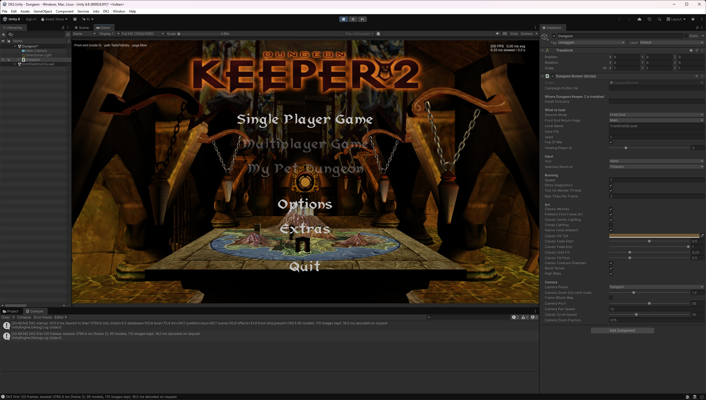
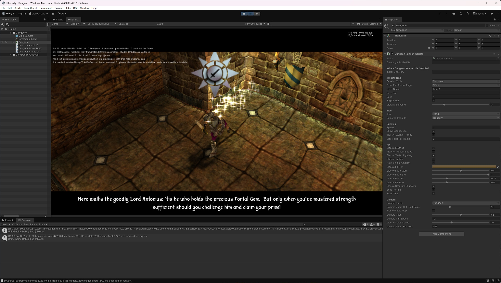

# Netherhold

A work-in-progress reimplementation of **Dungeon Keeper 2** in C#, with a Unity
presentation layer. The goal is to reproduce the original game's observable
behaviour, with the simulation kept independent of the renderer.

This is a development and research project, not a finished replacement for the
original game. Campaign compatibility, gameplay fidelity and the classic Unity
presentation are still being verified.

> **This wiki is a guide, not the source of truth.** The authoritative documents
> live in the repository under [`docs/`](https://github.com/franjom/netherhold/tree/master/docs),
> where they are versioned and checked with the code. Each wiki page links to them.

## Screenshots

More in the [README](https://github.com/franjom/netherhold#screenshots).

## How the project works

- **The original binary is the primary source.** Behaviour is researched in
  `DKII.EXE` with Ghidra and in the shipped data files before it is
  implemented. It is not reconstructed from memory of play.
- **Every claim carries a confidence level:** CONFIRMED (seen in the running
  game), STRONGLY INFERRED (read in the binary or the shipped data), HYPOTHESIS
  or UNKNOWN; function records add DISPUTED.
- **The simulation is deterministic.** It runs on integer ticks (4 per second,
  DK2's own rate), uses fixed-point maths and a seeded random source, and takes
  every balance number from the original game database.
- **Unity is presentation only.** No game rule or game state lives in the Unity
  project.

## Start here

| If you want to… | Go to |
|---|---|
| Build and run the tests | [Build and test (README)](https://github.com/franjom/netherhold#build-and-test) |
| Run it with your own DK2 installation | [Use an original DK2 installation](https://github.com/franjom/netherhold#use-an-original-dk2-installation) |
| Understand how the code is organised | [[Solution Map\|Solution-Map]] |
| See the layering rules and simulation rules | [ARCHITECTURE.md](https://github.com/franjom/netherhold/blob/master/docs/ARCHITECTURE.md) |
| Know what works today and what's next | [HANDOFF.md](https://github.com/franjom/netherhold/blob/master/docs/HANDOFF.md) |
| Read why things are the way they are | [DECISIONS.md](https://github.com/franjom/netherhold/blob/master/docs/DECISIONS.md) (ADRs) |
| Browse the reverse-engineering research | [`docs/research/`](https://github.com/franjom/netherhold/tree/master/docs/research) and [RESEARCH_STATUS.md](https://github.com/franjom/netherhold/blob/master/docs/RESEARCH_STATUS.md) |
| Contribute | [AGENTS.md](https://github.com/franjom/netherhold/blob/master/AGENTS.md) (research rules, evidence handling, documentation budgets) |

## Requirements at a glance

- The .NET SDK selected by [`global.json`](https://github.com/franjom/netherhold/blob/master/global.json) (.NET 10).
- Optional: the Unity editor version pinned in
  [`ProjectVersion.txt`](https://github.com/franjom/netherhold/blob/master/unity/DK2.Unity/ProjectSettings/ProjectVersion.txt)
  for the presentation.
- Optional: your own original DK2 installation, pointed to by `DK2_DIR`, for
  campaign content, the headless harness and the install-dependent tests.
  Without it the solution still builds, and those tests are reported as skipped.

## Legal

Project source is licensed under
[GPL-3.0-or-later](https://github.com/franjom/netherhold/blob/master/LICENSE).
The repository contains **no original DK2 game files**. Everything the game
needs is read at run time from your own installation. Dungeon Keeper is a
trademark of its owner. This project is not affiliated with or endorsed by
Electronic Arts or Bullfrog Productions. See
[THIRD-PARTY-NOTICES.md](https://github.com/franjom/netherhold/blob/master/THIRD-PARTY-NOTICES.md).
